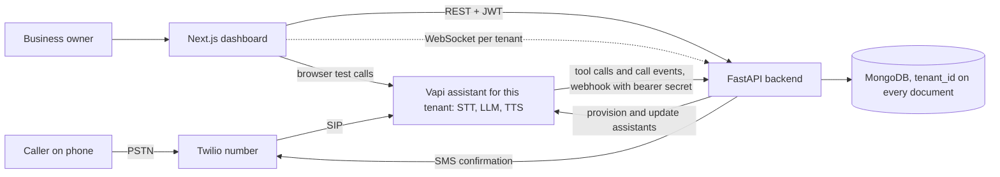
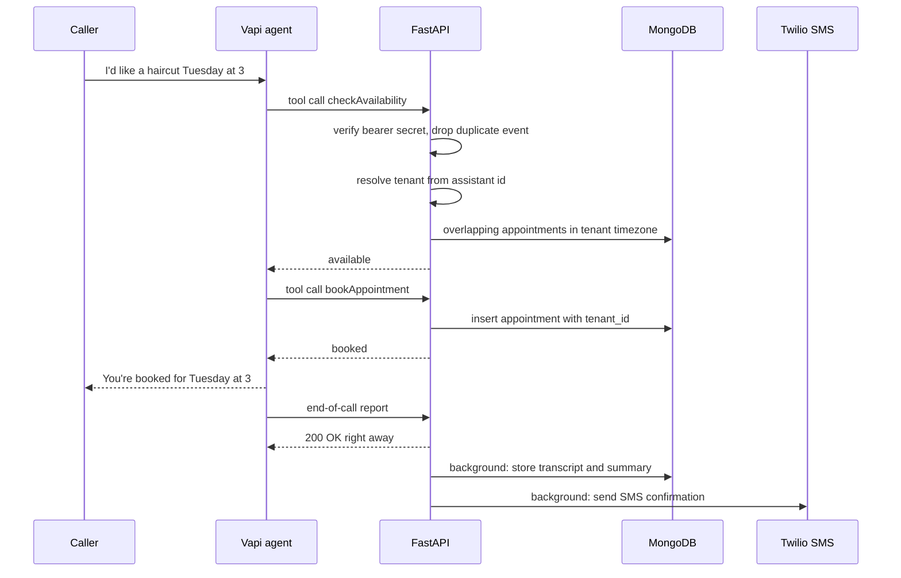

# Calleem: a multi-tenant AI voice receptionist

Personal project. Source: https://github.com/montaassarr/Calleem · Live: https://calleem.tech

## Context and problem

Small appointment-based businesses such as barbershops and clinics miss calls while they are busy, and every missed call can be a lost booking. Calleem gives each business its own AI voice agent. The agent answers the phone, checks real availability, books the appointment in the business's calendar and texts the caller a confirmation. Owners manage everything from a web dashboard: the agent's voice and prompt, services, opening hours, appointments and call transcripts.

## Constraints

- **Conversation latency.** The agent calls my backend in the middle of a sentence ("is Tuesday at 3 free?"), so tool calls must return within one conversational turn.
- **Multi-tenant from day one.** One codebase and one database, but each tenant has its own voice, prompt, services, hours, timezone and phone number.
- **Webhooks are internet-facing.** The voice platform sends them and retries them, so they must be authenticated and de-duplicated.
- **Per-tenant third-party secrets** (Twilio credentials) have to be stored in the database.
- **One developer and a small budget.** Telephony, speech and the LLM loop come from managed services. What I own is the business logic.

## Architecture

### A booking call

## Key design decisions and trade-offs

**Buy the voice loop, own the business logic.** Building my own STT, LLM and TTS pipeline would have meant solving telephony, barge-in and latency tuning myself, which is a product on its own. With Vapi, each tenant gets an assistant, created when the tenant is provisioned. The agent works only through five narrow tools: `checkAvailability`, `bookAppointment`, `getAvailableServices`, `getBusinessLocation` and `getCurrentDateTime`. It never touches the database directly. All state and rules stay in my backend, which is what makes the product testable. The costs are per-minute pricing, dependence on the vendor, and agent behavior that depends on prompt quality.

**Resolve the tenant on the server.** Every webhook needs a tenant. The backend looks up the tenant that owns the assistant ID of the call. It only falls back to the metadata written at provisioning time, and it never takes a tenant ID from free-form payload fields. One wrong tenant here would mean booking into another business's calendar.

**Authenticate webhooks, then de-duplicate them.**

- Vapi webhooks must carry a bearer secret, configured as a Vapi credential and compared in constant time (`hmac.compare_digest`).
- Twilio webhooks are checked with Twilio's request signature.
- Every Vapi event gets a key: the provider's event ID, or else the call ID plus the event type plus a payload hash. The key is inserted as the `_id` of a MongoDB document. The unique insert *is* the check, so two workers cannot both process the same retry.

I did not add Redis for this: MongoDB was already there, and the volume is small.

**Shared collections with `tenant_id`, not a database per tenant.** For small businesses, a database per tenant would cost more to operate and complicate migrations. Every document carries `tenant_id`. The JWT carries the user's role (owner, admin or super-admin) and tenant. The service layer scopes its queries with the tenant from the token. The risk with this model is that one missing filter leaks data. Backend tests cover router guards, webhook verification and encryption.

**Fast path versus slow path.** Tool calls are answered synchronously, because the caller is waiting. The end-of-call report is acknowledged at once, and its heavier work (storing the transcript and sending the SMS) runs as a background task. The voice platform then doesn't retry, and the conversation never waits for Twilio. The trade-off: FastAPI background tasks run in-process, so a crash at the wrong moment loses that work. There is no durable queue yet.

**Encrypted per-tenant secrets.** Twilio credentials are encrypted with AES-256-GCM before they are stored. The master key comes from the environment, and each value gets a fresh 96-bit nonce. Because GCM is authenticated, a tampered ciphertext fails to decrypt instead of producing garbage. This is simpler than a cloud KMS, but it offers no automatic key rotation and no hardware protection for the master key.

**A per-tenant event channel.** `/ws/{tenant_id}` requires a JWT, and the tenant in the token must match the tenant in the path. Otherwise the socket is closed with a policy-violation code. The backend broadcasts call start and end, status updates, transcript lines and tool usage. Connections live in an in-memory registry, which is fine for one backend instance but not for several.

**Other hardening.** Rate limiting per client IP (slowapi), secrets only from environment variables, and CSP and security headers on the frontend. The frontend has 104 Vitest tests and the backend more than 50 pytest tests. GitHub Actions runs both on every push, together with lint, a production build and Docker builds.

## What I'd improve next

Parts that are not finished yet:

- Inbound SMS and WhatsApp messages are received, stored and acknowledged automatically, but the AI does not answer them yet.
- Billing runs against a mock Stripe service by default.
- The dashboard doesn't use the WebSocket feed yet. It still fetches with React Query.

Design debt I know about:

- **Double-booking race.** Checking availability and then inserting is not atomic, so two simultaneous calls could book the same slot. A unique index on tenant and slot, or a transaction around check and insert, would close it.
- **De-duplication store.** It needs a TTL index so it doesn't grow forever. The fallback key should use a stable hash (SHA-256 of the canonical payload), because Python's built-in `hash()` differs between processes.
- **Durable background work.** A small job queue with retries for SMS and call-report processing.
- **Horizontal scaling for WebSockets.** Redis pub/sub between instances, plus short-lived connection tickets instead of JWTs in query strings, which end up in access logs.
- **Tenant scoping in one place.** A repository layer that refuses to query without a tenant, instead of relying on each query to add the filter.
- **Key management.** Envelope encryption with a managed KMS and key rotation.

## Stack

Python 3.11 · FastAPI · Pydantic v2 · Motor / MongoDB · JWT · AES-256-GCM (`cryptography`) · slowapi · Vapi · Twilio (SIP, SMS, WhatsApp) · OpenAI via Vapi · Next.js 16 (App Router) · React 19 · TypeScript · TanStack Query · Tailwind · WebSockets · Docker · GitHub Actions · pytest · Vitest
