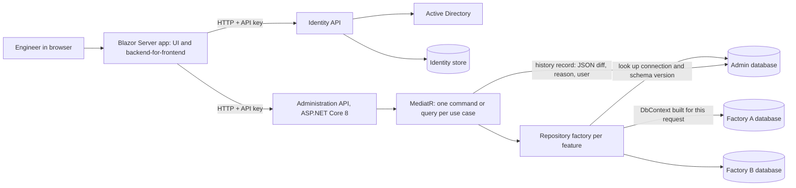

# PickPrint: a CQRS back office for a multi-factory shop-floor app

> Written from memory of my internship work; no proprietary code or data is included. I describe internal systems generically.

Socomec Group, IT department, 2026. PickPrint (now branded PLA) is a shop-floor verification app used in several factories. This case study covers its configuration side. Engineers use it to maintain products, subassemblies, product/subassembly associations with quantities, and workstations. The shop floor then verifies production against that configuration.

The team's backend follows the CQRS and versioned-schema conventions described below. I worked inside those conventions on the full-stack modernization. My main parts were:

- the audit trail, end to end
- the Excel import and export flows
- the batch endpoints behind the imports
- new commands and queries for features, following the versioned pattern

## Context and problem

- Each factory has its **own database**, and the schema differs by version. One deployment has to serve all of them, and the user picks the factory at runtime.
- Product configuration is quality data. Every change must be traceable: who changed it, when, exactly what changed, and why (a change reason). Before this work, history entries recorded that an entity changed but not the field-level diff or the reason.
- Engineering sends bulk data as Excel files with hundreds of rows. Imports must be validated before they touch production data, and they should not turn into hundreds of separate HTTP calls.

## Constraints

- The factory databases already exist and belong to the shop-floor system, so I cannot unify their schemas.
- The app is long-lived and internal, maintained by a small team. Predictability matters more than cleverness.
- Users sign in with corporate Active Directory accounts.
- The API has exactly one client: the Blazor app.

## Architecture

How a write flows:

1. A thin controller builds a command and sends it through MediatR.
2. The handler validates the input with guard clauses.
3. The handler asks the feature's repository factory for a repository bound to the selected factory's database.
4. The handler writes the change.
5. The handler dispatches a history command that records the change in the admin database.

Commands return a `Result<T, ValidationFailed>`. The controller maps it to `200` or `400` with `Match`. Expected failures never throw exceptions.

## Key design decisions and trade-offs

**CQRS at the code level, one file per use case.** Each command or query lives in one file together with its handler (`CreateProduct.cs`, `GetAllProducts.cs`). Controllers contain no business logic. Queries return DTOs directly, and commands return a `Result`. This is CQRS as code organization only: there are no separate read stores and no event sourcing, which this workload does not need. The cost is more files, plus MediatR indirection that makes "go to definition" less useful. In return, every feature looks the same, and each handler can be unit-tested with fake repository factories.

**Database-per-tenant, resolved on each request.** The admin database stores one record per factory database: the connection and the schema version. For each request, a feature's repository factory reads that record and switches on the version. It then builds a `DbContext` for that connection and returns the matching versioned repository. I rejected two alternatives:

- Registering one `DbContext` per factory at startup would need a redeploy every time a factory is added.
- A single shared schema is impossible, because the factory databases are not ours to change.

The costs:

- We cannot use `DbContext` pooling.
- Connection details become data that must be protected.
- Supporting a new schema version touches every layer in lockstep: entity, repository, contracts, mapping profile and Blazor fields. A written checklist covers this.

So far only one schema version is implemented. For any other version, the factory returns `null`, which surfaces as a validation error instead of a crash.

**Polymorphic JSON for versioned contracts.** Each request and response DTO has a base class plus a subclass per schema version, marked with `[JsonDerivedType]` and a version discriminator (System.Text.Json). AutoMapper `Include` chains map the base and versioned fields. The Blazor side mirrors the same DTOs. I considered and rejected:

- A loose dictionary or JSON blob, which would lose typing and validation.
- Separate endpoints per version, which would duplicate routes.

The trade-off is that discriminators must never change once published.

**Audit trail with field-level diffs and a mandatory reason.** Before calling the API, the UI opens a reason dialog, and every create, update and delete requires a change reason. For every mutation, the audit mechanism intercepts the command, compares the stored entity with the incoming one property by property, and serializes the differences as JSON (`{"Field": {"Old": ..., "New": ...}}`). It then records a history entry with:

- the entity, its key and the action
- the diff and the reason
- the user and a UTC timestamp
- the factory connection

Batch imports write one history record per row. The audit hooks into the command pipeline rather than the ORM for two reasons. First, the reason and the business description are only known at the command level, not in EF Core. Second, history lives in a different database from the data it describes. The cost is that the data write and the history write are not in one transaction, so a failure between them needs a retry or a reconciliation job.

**Excel parsing in the Blazor app, typed batches to the API.**

1. The Blazor app parses the uploaded `.xlsx` with ClosedXML.
2. It shows an editable verification grid. The grid checks required columns, keys duplicated inside the file or already in the database, and, for associations, references to subassemblies that don't exist. Users can fix cells or remove rows before anything is sent.
3. The confirmed rows go to the API as one typed batch request. The batch command inserts them with `AddRange` and a single `SaveChanges`: one round trip and one transaction, so the import is all-or-nothing.

The API never receives files, only typed DTOs. That means there is one validation path and no upload endpoint to secure. Export is also built in the Blazor app from data the page already has loaded, so the API has no export endpoint. The trade-off: because this is Blazor Server, "client-side" means the UI tier, not the browser. Large files use memory on the UI server, and a few validation rules exist both in the grid and in the handlers.

**Separate Identity API backed by Active Directory.** Credentials are checked against AD. Roles and claims live in the app's own identity store. The APIs only accept calls from the Blazor app, which sends an API key. This keeps the APIs simple. The downside is that the API trusts the user name the UI forwards, instead of authenticating the user itself.

## What I'd improve next

- **Move auditing into a MediatR pipeline behavior.** Commands would carry an `IAuditable` marker, so the history write could not be forgotten. I would also record the audit entry through an outbox, so a failed history write cannot silently drop an audit record.
- **Write history for batches in one insert** instead of one command per imported row.
- **Cache per-connection metadata** (schema version and server version detection) instead of resolving it on every request, and dispose of per-request contexts explicitly.
- **Forward a user token** (OIDC/JWT) from the Blazor app, so the API authorizes the real user instead of trusting an API key.
- **Add integration tests against real database engines** (Testcontainers) for each schema version. Today the tests are handler unit tests with fake repositories.

## Stack

ASP.NET Core 8 Web API · Blazor Server (MudBlazor) · MediatR · AutoMapper · EF Core · System.Text.Json polymorphic serialization · ClosedXML · FluentValidation (UI) · xUnit · Active Directory
