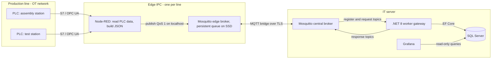
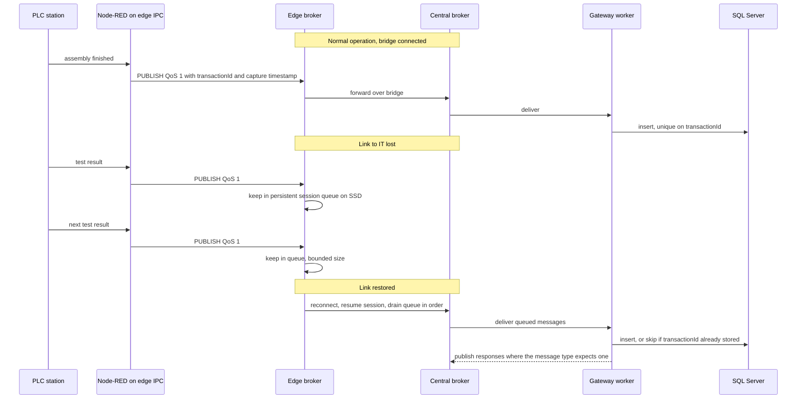

# Industrial IoT: an edge-to-IT traceability pipeline over MQTT

> Written from memory of my internship work; no proprietary code or data is included. I describe internal systems, sites and message catalogues generically.

Socomec Group, IT department, 2026. My role: I designed the target architecture and wrote its technical specification. That covered the transport layer, the topic convention, QoS and security rules, the payload contracts, the design of the C# gateway service, the data-access rules and the Grafana dashboards.

## Context and problem

PLCs on the assembly and test stations of each production line produce traceability data: serial numbers, assembly steps, and test results with measurements. This data has to end up in SQL Server. Stations also ask IT for data while they work: product parameters, bill of materials, or "did the previous station pass this unit?" before they allow the next step.

In the existing setup, every line had its own supervision PC running a dedicated C# application with direct SQL access. This caused five problems:

- There was one application per line to maintain.
- The supervision PC was a single point of failure for its line.
- Traffic between the plant floor (OT) and IT was not encrypted.
- Every new line layout needed custom code.
- There was no live view of production.

## Constraints

- **Brownfield.** PLC programs must not be rewritten, and the automation engineers are not software developers.
- **No lost records.** A unit without a traceability record cannot be traced. Data has to survive plant network outages and IT server restarts.
- **Some messages are request/response inside the production cycle.** A station waits for the answer, so latency matters (tens of milliseconds).
- **Security policy.** Traffic must be encrypted, anonymous clients are not allowed, and a compromised line must not be able to write another line's data.
- **Modest load and a small team.** Throughput is tens of messages per second for a whole plant. Components must be light and deployable with Docker Compose.
- **Existing contract.** An internal communication standard already defined the message types, so the new design had to keep it.
- **Several line layouts** (single station, multi-assembly, multi-test, test-only) must be supported without changing IT-side code.

## Architecture

Each line gets an industrial PC with two network ports, one on the OT network and one on the IT network. Node-RED reads PLC data and publishes JSON to a local Mosquitto broker. That broker is a **bridge client** of a central broker in the server room. The gateway is a .NET 8 Worker Service. It subscribes with wildcards, validates each message, runs the matching handler and publishes the response on the station's response topic.

Topics follow an ISA-95-style hierarchy: `<site>/<line>/<station>/<register|request|response>/<messageType>`. Because the gateway uses wildcards, it never needs to know which lines exist.

### Store-and-forward during an outage

The bridge runs with a persistent session (`cleansession false`), a bounded queue, and periodic autosave of the broker's state to disk. That is why the edge IPC uses an industrial SSD: SD cards wear out quickly under this write pattern. During an outage the line keeps producing and its records wait on the edge.

## Key design decisions and trade-offs

**One broker per line with bridging, not one central broker.** A single plant-wide broker is simpler, but when it fails, every line loses its link to IT at once. With edge brokers, each line keeps working on its own. For a line, an IT outage looks the same as a network cut. The cost is more brokers to deploy and monitor. To keep that manageable, every edge IPC uses the same Docker Compose template and a per-line config file.

**MQTT publish/subscribe instead of OPC UA client/server, HTTP, or direct SQL.** I built on an earlier internal protocol study that chose MQTT. Many PLCs with different cycle times fit an asynchronous publish/subscribe model better than client/server polling. MQTT is light on the network and supports TLS. Direct SQL from the line couples every station to the database schema and gives no security boundary.

**Mosquitto instead of EMQX or HiveMQ.** Mosquitto uses tens of megabytes of RAM, so it fits on a small edge PC, and one core handles far more than the plant's tens of messages per second. EMQX and HiveMQ clustering would add complexity with no benefit at this scale. The trade-off is that the central broker is not clustered. The edge queues absorb its restarts, and that is acceptable here.

**Node-RED at the edge instead of reprogramming PLCs.** Automation engineers can configure flows themselves. Differences between line layouts live in the edge flow. For example, a "previous station result" check can be answered locally from a Node-RED cache instead of a round trip to IT. This keeps the gateway independent of the layout: a new line means importing the matching flow, not changing C#. The cost is that logic in low-code flows needs version control, so flows are exported and versioned like code.

**Plain MQTT with JSON instead of Sparkplug B.** OT engineers can read JSON on the wire, it has no vendor lock-in, and it fits the existing request/response contract. Sparkplug B's Protobuf payloads and fixed topic structure did not match that contract. What we give up: Sparkplug's birth and death certificates. Liveness has to come from MQTT last-will messages and heartbeats instead.

**QoS 1 with idempotent writes, not QoS 2.** QoS 2 only guarantees exactly-once delivery per hop. Edge to central and central to gateway are separate sessions, so QoS 2 would not give end-to-end exactly-once anyway, and it costs extra round trips. Instead:

- Everything uses QoS 1 (at least once).
- Node-RED stamps each message with a UUID `transactionId` and a UTC timestamp taken when the data is captured. We don't use the PLC clock (it drifts) or the arrival time (it changes after an outage).
- A unique constraint in SQL Server turns duplicate deliveries into no-ops.

The result is effectively-once storage. QoS 0 is only acceptable for pure live metrics, never for traceability.

**Handlers check ordering instead of assuming it.** The bridge queue normally drains in order, but a retransmission can reorder messages. Handlers therefore don't trust arrival order. For example, a test result is rejected if its serial number has not been registered yet, instead of being written with a broken parent reference. Writes that span a header and its measurement rows run in one database transaction.

**Worker Service with the Strategy pattern instead of an ASP.NET Web API.** The gateway holds a persistent MQTT connection and has no HTTP surface. `BackgroundService` gives it clean startup and shutdown, reconnection with exponential backoff, and normal dependency injection. Each message type has its own handler class that implements one interface. The worker reads the message-type header and resolves the matching handler from DI. This avoids a growing `switch` block: adding a message type means adding one class. Every payload is validated against a JSON Schema before any database access. Handlers are fully async so they never block the MQTT client's receive loop.

**Back-pressure is bounded explicitly.** The edge queue has a maximum size, and the SSD is sized so that a realistic outage fits in it. "No data loss" therefore holds within that bound. If an outage lasted longer than the queue can hold, the broker would start dropping messages. I preferred a stated limit to a hidden one.

**Security in layers.**

- The bridge uses TLS: 1.3 is the target and 1.2 the minimum. Certificates come from an internal CA, and client certificates per IPC are recommended.
- No anonymous connections are allowed.
- Per-line ACLs on the central broker let a line publish only on its own `register` and `request` topics and read only its own `response` topics. Only the gateway may publish responses. A compromised edge PC therefore cannot fake another line's test results.

**Grafana reads SQL Server directly, not MQTT.** The dashboards (first-pass yield, output per line, results per station, quality alerts) query the database through a read-only account. The write path never waits for the read path. The first version relied on non-locking read hints so dashboard queries could not block inserts, plus indexes on time and lookup columns.

## What I'd improve next

- **Treat replays as success, not errors.** In the first version of the spec, registering an existing serial number returns a "duplicate" error. A replayed message with the same `transactionId` should instead return the original success response. Only a *different* transaction for the same serial is a real business duplicate. Otherwise every outage recovery triggers alarms on the line.
- **Acknowledge after commit.** The gateway should only acknowledge a message once the database transaction has committed (manual acknowledgement in the MQTT client). With automatic acknowledgement, a crash between receipt and commit loses the message.
- **Expire stale requests.** A request/response message queued during an outage is useless when it is replayed, because the station has already moved on. MQTT v5 message expiry, or a TTL field in the header, would let the gateway drop these messages.
- **Add a parking topic** for messages that fail validation or arrive before their parent, retried automatically instead of simply rejected.
- **Monitor queue depth** on each edge broker (broker system topics exported to Grafana alerts), so an outage is visible long before the queue fills up.
- **Use read-committed snapshot isolation** on the database instead of non-locking hints. Dashboards then get consistent reads without blocking writers.
- **Run two gateway instances with shared subscriptions**, so a gateway restart does not pause every line.

## Stack

Eclipse Mosquitto (edge and central, Docker Compose) · MQTT 3.1.1 · Node-RED · TLS with an internal CA · C# .NET 8 Worker Service · MQTTnet · System.Text.Json and JSON Schema · EF Core · SQL Server · Grafana
