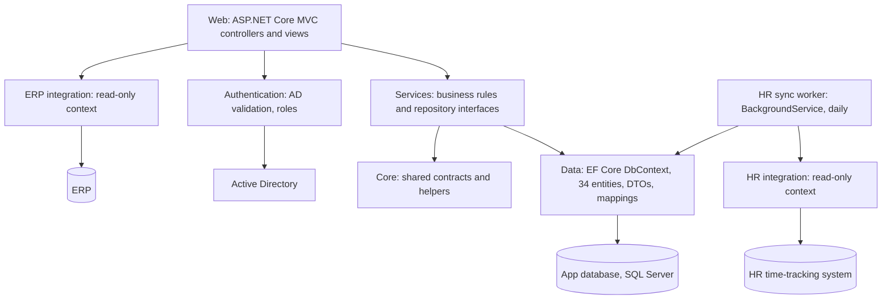

# Gestion Formation: from a monolith to an N-tier platform with HR and ERP sync

> Written from memory of my internship work; no proprietary code or data is included. I describe internal systems generically.

Socomec Group, IT department, 2026. Gestion Formation is an internal training-management platform for production staff. It covers training sessions, workstation qualifications, a skills versatility matrix, autonomy validations, retraining, and dashboards on top of all of these.

## Context and problem

The platform began as a single web application where controllers, data access and integration code were mixed together. That became painful as workflows piled up: every new feature touched everything.

Employee master data lives elsewhere. The HR time-tracking system (Bodet) knows who works where and who has left. The ERP (Sage) holds the employee's administrative record. Users sign in with their corporate Active Directory account.

The goals:

- Split the application into clear layers, so new workflows (more than ten were planned) don't leak into controllers.
- Keep employee data consistent with HR and ERP without manual re-entry.
- Use AD for sign-in.

## Constraints

- **The app is not the source of truth.** HR and ERP own employee data. The app keeps its own copy only so it keeps working when those systems are slow or unavailable.
- **On-premises environment:** .NET 8 MVC, SQL Server, a Windows domain.
- **Small team.** The structure has to be obvious to the next developer.
- **Leavers must lose access**, but their training history is compliance evidence and matters for audits.

## Architecture

The solution has eight projects: web, services, data, core, authentication, ERP integration, HR integration, and a separate worker. Each library exposes one `IServiceCollection` extension that registers its own DbContext, repositories and services. The web app's `Program.cs` therefore only composes modules. The worker reuses the data and HR integration projects without referencing the web app.

## Key design decisions and trade-offs

**Layers as separate projects, not folders.** Project references make dependency direction visible and mostly enforced at compile time: services depend on data, and nothing depends on the web project. Each project owns its DI registration, so a layer can be reused by another host, as the worker does. The cost is more ceremony per feature (entity, DTO, mapping, repository interface, service, controller) and slower navigation for newcomers. One leak remains: the web project still references the data project for some DTOs.

**Integration through read-only EF Core contexts, isolated in their own projects.** Each external system gets its own project with its own read model and context. Only the fields we need are mapped, and they are translated into the app's DTOs with AutoMapper. Reading the vendors' databases through a read-only account was the practical option on-premises. Isolating it means that switching to an API later only touches that project: an anti-corruption layer in miniature. The trade-off is coupling to vendor schemas that can change on upgrade.

**Pull ERP data on demand, sync HR data in the background.** The two systems are used differently:

- ERP data is only needed when a user is onboarded, to pre-fill the profile from the employee number. It is fetched at that moment.
- HR status changes (mainly departures) must be reflected for everyone, whether or not anyone looks at them, so a scheduled job handles them.

Treating both the same way would either sync ERP data nobody reads or make HR checks depend on user activity.

**A separate Worker Service instead of work inside the web app or a database job.** The HR sync runs as a .NET `BackgroundService` in its own process. It has its own lifecycle and restarts, and it keeps the web app responsive. Once a day it:

- marks users inactive when the HR system shows they have left, and stamps the date
- removes accounts that have been inactive for more than six months

Daily is enough, because a departure does not need to be reflected within seconds. The trade-offs: data can be up to 24 hours stale, the simple delay loop runs at "startup time plus N days" rather than at a fixed hour, and nothing prevents two instances from running at once.

**AD for authentication, the app database for authorization.** At sign-in, the credentials are validated against the domain, and then an ASP.NET Identity cookie session is issued. Profile attributes (display name, e-mail, department, manager, title, photo) are read from AD when a user is registered. Roles stay in the app's own store. This way the app never stores corporate passwords and still controls its own permissions. The cost: it is a form login, not single sign-on, so the password passes through the app.

**DTOs and AutoMapper between layers.** Views and controllers never bind directly to EF entities. This prevents over-posting and keeps the 34-entity model free to change without breaking screens.

## What I'd improve next

- **Proper scheduling and run history for the sync.** A fixed-time schedule (Quartz or Hangfire) with logged runs, alerting on failure, and a lock so only one instance runs.
- **Set-based sync queries.** Load all relevant HR records in one query instead of one lookup per user.
- **Anonymize instead of hard-deleting** long-inactive users. Access is removed and personal data minimized, but the training records remain as audit evidence.
- **Remove the web-to-data project reference**, so the web layer can only reach data through services.
- **Single sign-on** (Windows authentication or OIDC against the directory) instead of a login form.
- **Unit tests on the services layer and health checks** for the external integrations.

## Stack

.NET 8 · ASP.NET Core MVC · EF Core · SQL Server · BackgroundService / IHostedService (Worker Service) · AutoMapper · ASP.NET Identity · Active Directory · Bodet HR · Sage ERP · SCSS · DataTables
