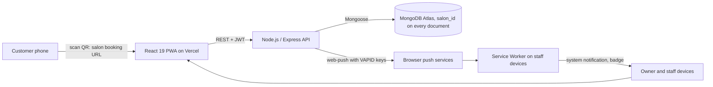
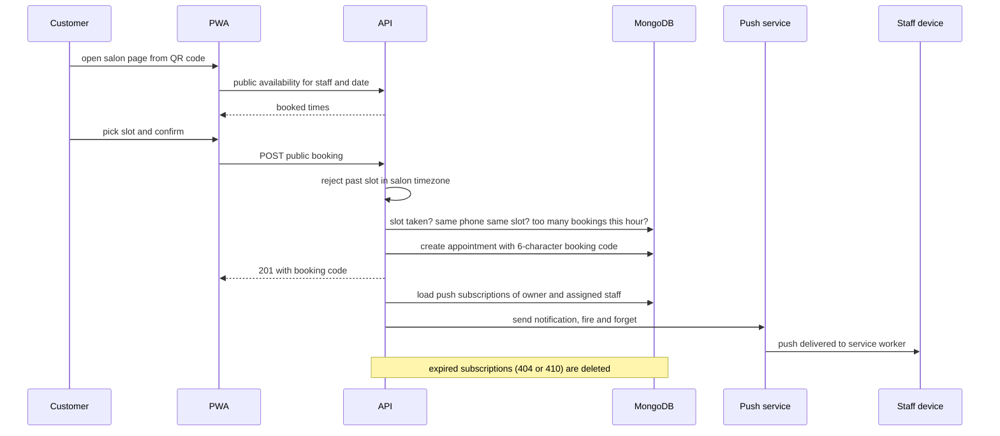

# Treservi: a multi-tenant salon booking PWA

Personal project. Source: https://github.com/montaassarr/treservi · Live: https://treservi.vercel.app

## Context and problem

Many salons and barbershops in Tunisia take bookings by phone and through social-media messages, and the owner reconciles everything by hand. Treservi gives each salon:

- a public booking page that customers open by scanning a QR code at the counter
- a dashboard for the owner and staff
- instant notifications on staff phones when someone books

The first version ran on Supabase: Postgres, plus Realtime channels (WebSockets) to refresh dashboards live. I moved it to my own Node.js/Express API on MongoDB Atlas, and replaced the realtime subscriptions with Web Push. This case study is mostly about why.

## Constraints

- **Staff use phones, and the app is usually closed.** A notification must reach a device even when no tab is open.
- **Customers book without an account.** That invites spam and duplicate bookings.
- **Free or low-cost hosting.** The API host can sleep when idle, so nothing can depend on long-lived connections.
- **One timezone for now (Tunisia).** A slot's validity must be judged in the salon's local time, not the server's.
- **One developer.**

## Architecture

### A public booking

## Key design decisions and trade-offs

**Web Push instead of WebSockets.** Realtime channels only deliver while a tab is open, and a salon's staff mostly have the app closed and the phone locked. Web Push reaches the service worker even when the app is closed, including home-screen PWAs on iOS. It also needs no persistent connection, which suits a host that sleeps when idle. The API sends to every subscription of the salon owners and the assigned staff member, and deletes subscriptions the push service reports as gone. The trade-off: push is a best-effort notification, not a data stream. Delivery depends on the browser vendors, and an open dashboard refreshes when it loads rather than updating live. I accepted that, because the problem was "staff don't know a booking happened", not "the calendar must update within 100 ms".

**Leaving the backend-as-a-service.** Moving from Supabase to my own Express API meant writing authentication, validation and queries myself. In exchange, the booking rules below live in one place that I control and can test, instead of being spread across database policies and client code.

**One shared database, `salon_id` on every document.** A salon is a tenant, and its unique slug forms the public URL and the QR code. A database per tenant would have been overkill for a handful of salons on a free Atlas cluster. The price is that isolation depends on the API applying the salon filter correctly on every route, which is exactly where I later found bugs (see the authorization audit below).

**QR self-booking without customer accounts, with abuse controls.** Asking customers to create an account adds friction at the counter. Instead, the owner's dashboard generates a QR code with the salon's booking URL. The customer books with a name and a phone number and gets a 6-character booking code. The code uses an alphabet without look-alike characters such as 0/O and 1/I. The code plus the phone number lets the customer cancel or reschedule later. With no login, the API enforces:

- no slot in the past, in salon time
- no second active booking on the same staff slot (`409`)
- no duplicate booking by the same phone for the same slot
- at most three bookings per phone per hour (`429`)
- cancellation only up to 30 minutes before the appointment

**Authorization audit: pin the tenant to the token, not the request.** When I reviewed every route, I found that many only checked that the caller was logged in. A staff member could read another salon's staff list by passing a different `salonId`, edit any user through a PATCH that passed the whole request body to the database (including `role`), and delete owners. Password hashes were also serialized in responses. I fixed it in one place instead of route by route: a `requireRole` guard, a `resolveSalonId` helper that pins owners and staff to the salon in their token (only a super-admin may choose another one), explicit field whitelists for every update, ownership checks *before* any write, and `passwordHash` excluded at the model level. Integration tests (supertest + in-memory MongoDB) now try the cross-tenant and privilege-escalation attacks and must fail. The lesson: in a shared-database design, tenant isolation has to be a default enforced by shared code, not something each handler remembers.

**Roles in the token, stricter limits on sensitive routes.** The JWT carries the role (super-admin, owner or staff) and the salon. The super-admin API is mounted on a configurable base path and has its own rate limiter. Auth routes have their own rate limiter. Only that salon's owner or a super-admin can edit salon settings. Helmet sets the security headers, and seed routes only exist when an environment flag enables them.

**A caching strategy per request type in the service worker.**

- Static assets: cache-first with background revalidation, so the app starts instantly.
- Navigations: network-first with an offline fallback page.
- API calls: never cached. A stale list of bookings is worse than a clear "you're offline".

So offline support covers the app shell, not the data.

**Maintenance on read instead of a scheduler.** When appointments are read, past active bookings are marked completed and cancelled ones are purged. That saves running a cron job on free hosting. The cost is that reads also do writes, and the work grows with the data.

## What I'd improve next

- **Short-lived tokens.** The role and salon live in a JWT that is valid for 7 days, so a demoted or deleted user keeps access until it expires. Short access tokens plus refresh tokens, or a token version checked on each request, would close that gap.
- **Prevent double bookings at the database.** The conflict check reads first and then inserts. A unique partial index on salon, staff, date and time for active bookings would make the check atomic.
- **Live dashboards on top of push.** The service worker already posts a message to open tabs when a push arrives. The dashboard should listen for it and refetch.
- **Real offline writes or none.** A background-sync handler exists, but nothing queues requests for it yet. I would either queue writes in IndexedDB or remove the handler.
- **Move the AI assistant's Gemini calls behind the API**, so no provider key is ever shipped to the browser.
- **Proper date-time fields per salon timezone** instead of date and time strings with a fixed timezone, and a scheduled job for maintenance instead of doing it on read.
- **Backend tests.** The booking rules above deserve unit tests. Right now the backend only has a health check test.

## Stack

React 19 · Vite · TypeScript · Tailwind CSS · Service Worker · Web Push API · qrcode.react · Node.js · Express · Mongoose · MongoDB Atlas · web-push (VAPID) · JWT · bcrypt · Helmet · express-rate-limit · Docker · Vercel · GitHub Actions
